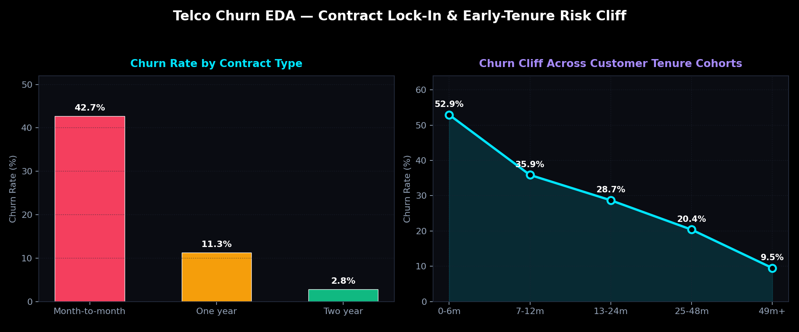
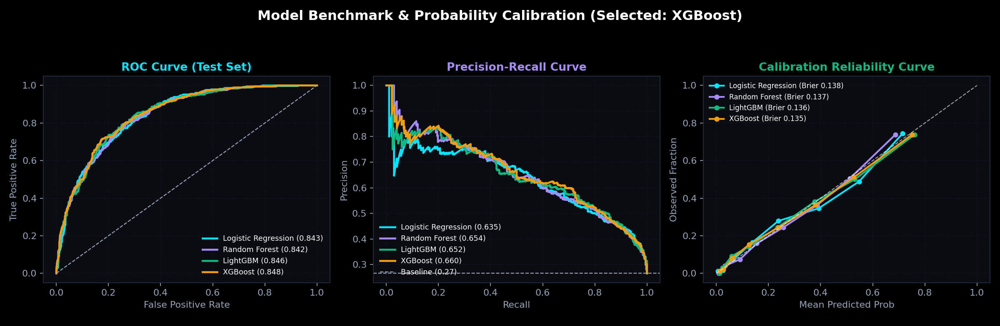
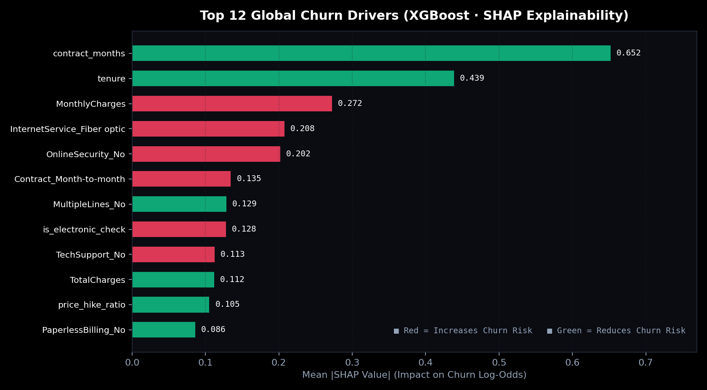
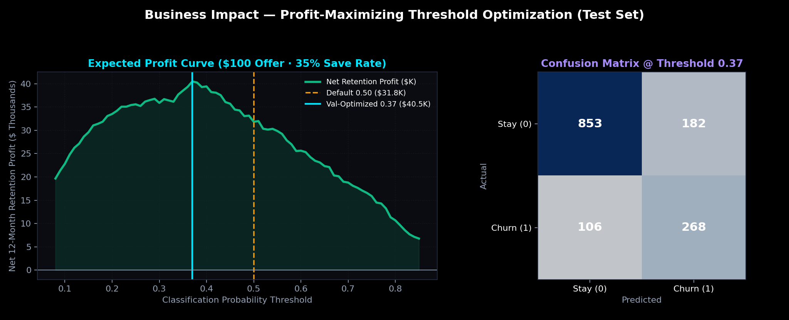

# Telco Customer Churn — Explainable ML & Financial Retention ROI

[](https://github.com/mostafasaad91/telco-churn-retention-roi/actions/workflows/ci.yml)


End-to-end **SQLite + Python + XGBoost + SHAP** customer churn investigation built on the real **IBM Telco Customer Churn** dataset (**7,043 customers**, 21 raw features).

Rather than stopping at model accuracy, this project optimizes the **classification threshold strictly for net 12-month financial profit** and generates a per-customer actionable retention list with top-3 SHAP drivers.

---

## Executive Results (Held-Out Test Set · n = 1,409)

| Model | 5-Fold CV AUC | Test ROC-AUC (95% CI) | Test PR-AUC | Test Brier |
| :--- | :---: | :---: | :---: | :---: |
| Naive Baseline | 0.5000 | 0.5000 | 0.2654 | 0.2654 |
| Logistic Regression | 0.8480 | 0.8425 `[0.819, 0.865]` | 0.6348 | 0.1378 |
| Random Forest | 0.8490 | 0.8417 `[0.820, 0.863]` | 0.6536 | 0.1373 |
| LightGBM | 0.8470 | 0.8458 `[0.823, 0.867]` | 0.6516 | 0.1357 |
| **XGBoost (Selected)** | **0.8499** | **0.8478 `[0.826, 0.869]`** | **0.6597** | **0.1347** |

### Business Impact (Threshold Optimization on Validation → Evaluated on Held-Out Test)
- **Unit Economics:** `$100` retention offer cost · `35%` save rate on true churners · `12 × MonthlyCharges` LTV preserved.
- **Default Threshold (`0.50`):** Targets `301` customers → catches `192` churners → **`$31,835.30`** net profit.
- **Validation-Optimized Threshold (`0.37`):** Targets `450` customers → catches `268` churners → **`$40,492.05`** net profit (**+$8,656.75 / +27.2% profit lift** on the 20% test slice alone!).

---

## Visual Highlights (AMOLED Edition)






---

## Project Architecture

```text
telco-churn-retention-roi/
├── data/raw/Telco-Customer-Churn.csv   # Real IBM Telco dataset (7,043 rows)
├── sql/01_schema_and_views.sql         # SQLite QA audit + feature & segment views
├── src/run_pipeline.py                 # Full SQL -> ML -> SHAP -> ROI -> Figures pipeline
├── outputs/
│   ├── metrics.json                    # Verified CV, Test, Bootstrap CI, Slice Audit & ROI
│   ├── high_risk_action_list.csv       # Top 50 at-risk customers + individual Top-3 SHAP drivers
│   └── figures/                        # 4 publication-grade AMOLED figures
├── docs/PROJECT_STORY.md               # Why, How & Every Question/Challenge Faced (EN + AR)
└── tests/test_pipeline.py              # Automated integrity & metric verification suite
```

## Quick Start

```bash
pip install -r requirements.txt
python src/run_pipeline.py
python tests/test_pipeline.py
```

Read the full engineering story, design decisions, and Q&A in **[docs/PROJECT_STORY.md](docs/PROJECT_STORY.md)**.

**Author:** Mostafa Saad · [Portfolio](https://mostafasaad91.github.io/?track=data) · [LinkedIn](https://www.linkedin.com/in/mostafa-saad-171086191/)
